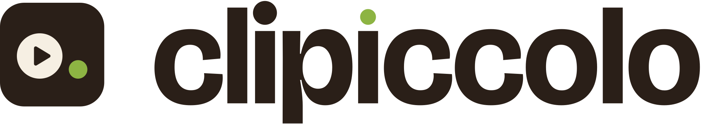

<h1>
  <picture>
    <source media="(prefers-color-scheme: dark)" srcset="brand/lockup-dark.svg">
    
  </picture>
</h1>

Drop a video in, get a small MP4 next to it that is easy to upload, share or attach to a ticket. For Windows 10/11
and macOS on Apple Silicon.

<p>
  <a href="LICENSE"></a>
  <a href="https://buymeacoffee.com/hubertmk"></a>
</p>

## Why this exists

Clipiccolo came out of a personal need. We kept sharing screen recordings and phone clips in chats, mails and
tickets at their original size, and those files quietly filled up storage everywhere they landed. Making them
smaller first was always possible; it just meant opening a video tool and making decisions nobody wanted to make
every time.

Nothing here is new or revolutionary. ffmpeg does all the real work, and plenty of other tools can shrink a video
too. Clipiccolo only packages that in a way that, from my point of view, anyone can use without thinking about it:
copy or drop a video, switch to the app, paste the small version wherever it was going. No account, no upload, one
quality choice.

If it saves you a bit of storage and a few clicks as well, that's all it's meant to do.

## Install

**Windows:** run `Clipiccolo-Setup-<version>.exe` → Install. No admin rights, nothing else to install first: it puts the app
and ffmpeg in `%LOCALAPPDATA%\Clipiccolo`, adds a Start-menu entry (and a desktop shortcut if you tick it), and
installs Microsoft's WebView2 runtime first on the rare PC that lacks it (that part needs internet). Remove it under
Settings → Apps. Silent install for IT: `Clipiccolo-Setup-<version>.exe /S`.

Coming from **Clip Shrinker** (0.4.1 or older)? Uninstall it first under Settings → Apps; Windows treats Clipiccolo as a
new app, so the two would otherwise sit side by side. Your settings carry over on the first start.

**Mac (Apple Silicon, macOS 11 or newer):** open `Clipiccolo-<version>-mac-arm64.dmg` and drag Clipiccolo into
Applications. The app is signed with a Developer ID and carries ffmpeg; nothing else to install. Intel Macs are not
covered by this build. Remove it by moving the app to the Bin. The first time Clipiccolo looks at something you
copied, recent macOS versions ask whether it may "access data from other apps": allow it, that is the whole trick
(it can be changed later under System Settings → Privacy & Security).

## Use

Start Clipiccolo from the Start menu (Mac: Launchpad or Applications). Drop videos on the window (or on the .exe or
Dock icon), or click Browse. Each file becomes `<name> - piccolo.mp4` in the same folder, or in the folder set under
Settings (gear icon) → Save converted videos (Default = next to the original). Show opens Explorer (Finder) with the
converted file selected. Several files queue up and run one after another. Settings live in
`%APPDATA%\io.github.hubertmk.clipiccolo\settings.json`
(Mac: `~/Library/Application Support/io.github.hubertmk.clipiccolo/settings.json`).

**Clipboard and links** (on the Mac, read ⌘ for Ctrl and Finder for Explorer)

- **In:** Ctrl+V pastes video files copied in Explorer, paths ("Copy as path") or http(s) links to a video. With
  Settings → *Convert copied videos* on (default), just switching to Clipiccolo after copying a video starts it.
  Links are downloaded with the system's own curl (HLS `.m3u8` goes straight to ffmpeg) and saved to the output folder,
  or Downloads.
- **Out:** with Settings → *Copy converted videos* on (default), the finished videos go to the clipboard when a
  batch is done, with a short "Fatto. Copied to clipboard." toast. That happens right away if Clipiccolo is in front, or as
  soon as you switch back to it. If you copied a new video in the meantime, that one is converted first. Then Ctrl+V
  pastes them anywhere. Copy (per video), Copy all, Ctrl+C and dragging a finished row out work too.

| Quality | Long side | Frame rate | CRF | Audio |
|---|---|---|---|---|
| Small | ≤ 1280 px | ≤ 30 fps | 30 | AAC 64 kb/s |
| Balanced (default) | ≤ 1920 px | ≤ 30 fps | 26 | AAC 96 kb/s |
| Sharp | ≤ 2560 px | ≤ 60 fps | 22 | AAC 128 kb/s |

Never upscales, never raises the frame rate, keeps portrait videos portrait. H.264 + `faststart`, so it plays in the
browser straight from wherever it is uploaded. Input is anything ffmpeg reads (mov, mp4, mkv, avi, webm, wmv, gif, …).

## How it's put together

| Part | What |
|---|---|
| `build-installer.ps1` → `dist\Clipiccolo-Setup-<version>.exe` | The installer people get (Tauri's NSIS bundler, per-user, ~28 MB) |
| `build-mac.sh` → `dist/Clipiccolo-<version>-mac-arm64.dmg` | The Mac build: `Clipiccolo.app` for Apple Silicon with ffmpeg inside, signed and notarized, on a disk image. `src-tauri/tauri.macos.conf.json` holds everything macOS-only (native title bar, DMG layout, file types) on top of `tauri.conf.json` |
| `launcher/` → `Clipiccolo.exe` | Portable alternative: one file, no install. Unpacks the app, `WebView2Loader.dll` and ffmpeg into `%LOCALAPPDATA%\Clipiccolo\<version>` once, then starts the app with the same arguments |
| `src-tauri/` → `ClipiccoloApp.exe` / `Clipiccolo.app` | Tauri app: runs ffmpeg per file (no console window), reports progress, Cancel kills it. `clip.rs`: clipboard in/out, drag-out, link parsing; Win32 in `win`, AppKit in `mac` |
| `ui/` | HTML/CSS/JS, tokens from `brand/tokens.css`, fonts in `ui/fonts`. The "Due punti" look is described in `DESIGN.md` |
| `site/` | The website: `index.html` (one long page with anchor sections) and `privacy/index.html`, sharing `site.css`; fonts self-hosted in `site/fonts`, no third-party requests. Static, so any host that serves files works |
| `brand/` | Masters: mark, wordmark, lockups (SVG), tokens. `python brand/build.py` regenerates them, `src-tauri/icons/` (app icons for both platforms, installer header and sidebar, DMG background), `brand/png/social.png` (link preview; also upload it as the GitHub social preview) and `site/og.png`. The rules are in `DESIGN.md` |
| ffmpeg | Windows: gyan.dev 8.0 "essentials" build. Mac: Martin Riedl's static arm64 build. Both GPL v3, licence next to the binary |
| Fonts | Bricolage Grotesque and DM Mono (SIL OFL 1.1, licences in `ui/fonts`) |

The installed app links the C runtime statically and WebView2 in, so it needs nothing beyond Windows 10/11 and the
WebView2 runtime (the installer handles that). The Mac app uses the system's WebKit and needs macOS 11 or newer.

## Build the installer (Windows)

Needs Rust (MSVC toolchain), the Tauri CLI (`cargo install tauri-cli --version "^2"`) and ffmpeg.exe from
[gyan.dev](https://www.gyan.dev/ffmpeg/builds/) (release "essentials" zip, `bin\ffmpeg.exe`).

```powershell
$env:FFMPEG_EXE = "C:\path\to\ffmpeg.exe"   # once; it's copied to src-tauri\resources\ffmpeg.exe (git-ignored)
.\build-installer.ps1
# → dist\Clipiccolo-Setup-<version>.exe
```

**Bump `version` in `src-tauri/tauri.conf.json` (and `Cargo.toml`) for every release** so the installer upgrades in place.

Then, for the portable exe on Windows (needs `pip install zstandard`; packs the app and ffmpeg of the build above):

```powershell
.\build-portable.ps1
# → dist\Clipiccolo.exe
```

## Code signing

Windows builds are signed with Clipiccolo's own **self-signed** certificate (`CN=Clipiccolo`, public part in
`signing/clipiccolo-codesign.cer`). The build scripts sign automatically when that certificate (with its private key)
is in your certificate store, and warn and build unsigned when it isn't.

- `signing\new-cert.ps1` creates it (once), puts it in `Cert:\CurrentUser\My`, and saves a password-protected
  `.pfx` to `%USERPROFILE%\.clipiccolo-signing\` (keep that private).
- `signing\sign.ps1` is the one place that calls signtool; Tauri runs it for the app exe, the bundled ffmpeg,
  the NSIS plugins, the uninstaller and the installer.
- GitHub builds: `.github/workflows/release.yml` imports the `.pfx` from the repository secrets
  `SIGNING_PFX_BASE64` and `SIGNING_PFX_PASSWORD`.

A self-signed signature proves two downloads came from the same key, but Windows doesn't trust it: SmartScreen still
warns and the publisher shows as unknown. That only changes with a certificate from a trusted CA (or Azure Artifact
Signing); `sign.ps1` is where that would plug in. An organisation can trust our builds by importing the `.cer` into
"Trusted Root Certification Authorities" and "Trusted Publishers" (e.g. by group policy).

The Mac app is signed with an Apple Developer ID certificate and notarized instead; see [Build the Mac app](#build-the-mac-app-macos-on-apple-silicon).

## Build the portable launcher (cross-compiled from Linux)

```bash
# once: mingw-w64, Rust std source at $(rustc --print sysroot)/lib/rustlib/src/rust/library, pip install zstandard
export RUSTC_BOOTSTRAP=1   # for -Zbuild-std (see .cargo/config.toml)
(cd src-tauri && cargo build --release --target x86_64-pc-windows-gnu)
FFMPEG_EXE=/path/to/ffmpeg.exe python3 pack_payload.py
(cd launcher && cargo build --release --target x86_64-pc-windows-gnu)
# → launcher/target/x86_64-pc-windows-gnu/release/Clipiccolo.exe
```

On Windows, use `build-portable.ps1` instead (MSVC: WebView2 links statically, so the launcher only carries the
app and ffmpeg).

**Bump the version in `launcher/Cargo.toml` for every release.** The launcher unpacks into a per-version folder,
skips files that are already there, and removes the folders of older versions once the new one has started.

## Build the Mac app (macOS on Apple Silicon)

Needs Xcode's command-line tools, Rust, the Tauri CLI (`cargo install tauri-cli --version "^2" --locked`) and a
static arm64 ffmpeg from [ffmpeg.martin-riedl.de](https://ffmpeg.martin-riedl.de/) (macOS → arm64 → release →
`ffmpeg.zip`; a GPL build with libx264 and no "nonfree" parts, with a `.sha256` next to it).

```sh
export FFMPEG_BIN=/path/to/ffmpeg   # once; it's copied to src-tauri/binaries/ffmpeg-aarch64-apple-darwin (git-ignored)
./build-mac.sh
# → dist/Clipiccolo-<version>-mac-arm64.dmg
```

The script signs with the first "Developer ID Application" certificate in the keychain (or `$APPLE_SIGNING_IDENTITY`;
without one it signs ad hoc, which only runs on the build Mac). For a build other Macs open without a detour it also
needs notarization credentials in the environment, one of:

- `APPLE_ID`, `APPLE_PASSWORD` (an [app-specific password](https://support.apple.com/102654)), `APPLE_TEAM_ID`;
- `APPLE_API_ISSUER`, `APPLE_API_KEY`, `APPLE_API_KEY_PATH` (an App Store Connect API key);
- `APPLE_KEYCHAIN_PROFILE`, a profile saved once with `xcrun notarytool store-credentials`.

Without them the app is signed but not notarized, and macOS asks the user to allow it under System Settings → Privacy &
Security. `cargo tauri dev` (in `src-tauri`) runs the app unbundled; it needs the ffmpeg sidecar in place too.

## Known limits
- Windows builds are signed with a self-signed certificate only (see [Code signing](#code-signing)), so SmartScreen still shows (for the installer and the portable exe) "Windows protected your PC" on first run → More info → Run anyway.
- Portable exe only: first start unpacks ~100 MB into `%LOCALAPPDATA%\Clipiccolo` (about a second); later starts are instant.
- Mac: Apple Silicon only, macOS 11 or newer. The portable single-file launcher is Windows-only (the `.app` already is one folder).

## Contributing

Issues and pull requests are welcome. See [CONTRIBUTING.md](CONTRIBUTING.md).

## Support

Clipiccolo is free and open source, with no account and no upsell. If it saved you a few minutes, you can
[buy me a coffee](https://buymeacoffee.com/hubertmk). Grazie.

## License

Clipiccolo is released under the [MIT License](LICENSE).

The installer, the portable exe and the Mac app also bundle FFmpeg, which is licensed under GPL v3 and runs as a
separate program, plus open-source Rust crates, Lucide icons and (on Windows) Microsoft WebView2. See
[THIRD-PARTY-NOTICES.md](THIRD-PARTY-NOTICES.md) and [THIRD-PARTY-LICENSES.html](THIRD-PARTY-LICENSES.html).
